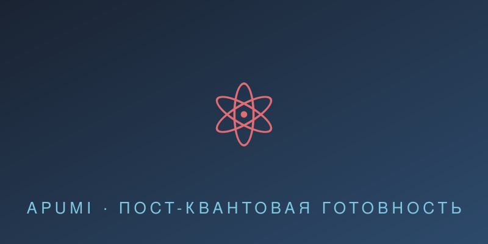

# PQC Migration — Quantum Readiness & NIST IR 8547 Scanner

**Zero-dependency cryptographic inventory scanner (29/29 PROVEN checks) detecting quantum-vulnerable RSA/ECDSA primitives and generating SARIF & CBOM migration artifacts.**

## Key Capabilities
- **Zero-Dependency Stdlib Engine:** Scans source repositories offline with zero third-party packages.
- **NIST PQC Mapping:** Maps legacy RSA/ECC usage directly to **FIPS 203 (ML-KEM)** and **FIPS 204 (ML-DSA-65)** migration targets.
- **SARIF & CBOM Output:** Produces CI/CD-ready `results.sarif` and `cbom.json` artifacts for security audits.

## Get the Commercial PQC & ML-DSA-65 Audit Kit ($199)
Includes the zero-dependency PQC scanner (`pqc_readiness_scanner.py`), reference SARIF/CBOM schemas, CI/CD workflow, and commercial license.
Contact **apumiaaifund@gmail.com** or visit **https://github.io**.
